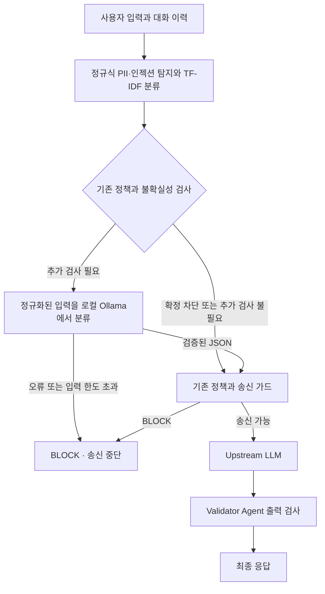

# Ollama 적응형 입력 탐지

전문가 멘토링의 문맥 판단과 처리 비용에 대한 피드백을 반영했다. 정규식 PII·인젝션 탐지와 TF-IDF 기반 분류를 먼저 적용한다. 입력 검사가 어려운 일부 요청에만 로컬 모델 추론을 추가한다.

## Windows에서 실행

1. [Ollama for Windows](https://docs.ollama.com/windows)를 설치한다. Ollama 서버에 `OLLAMA_NO_CLOUD=1`을 설정하고 Ollama 앱을 재시작한다. 서비스에는 루프백만 바인딩하고, 모델을 받은 뒤 운영 환경에서 Ollama 프로세스의 외부 통신을 차단한다. [Ollama FAQ](https://docs.ollama.com/faq)
2. `ollama pull qwen2.5:1.5b`로 모델을 준비한다. 한국어·영어 처리를 지원하는 1.5B 모델을 기본값으로 선택했다. 배포 전 사용하는 하드웨어에서 워밍업과 대기 시간을 확인한다. [Ollama 모델 페이지](https://ollama.com/library/qwen2.5:1.5b)
3. 프록시를 시작할 PowerShell 세션에서 다음 값을 설정한다. 다른 로컬 모델은 `OLLAMA_MODEL`에 지정한다.

```powershell
$env:OLLAMA_ENABLED = "true"
$env:OLLAMA_BASE_URL = "http://127.0.0.1:11434"
$env:OLLAMA_MODEL = "qwen2.5:1.5b"
$env:OLLAMA_TIMEOUT_SECONDS = "15"
$env:OLLAMA_MAX_INPUT_LENGTH = "4000"
$env:OLLAMA_THRESHOLD_MARGIN = "0.10"
$env:DETECTION_MODE = "hybrid"
python -m evaluation.adaptive_compare --health
```

상태가 `ready`이면 [기존 실행 안내](../README.md#실행-방법)에 따라 프록시를 실행한다. `OLLAMA_ENABLED=false`로 설정하고 프록시를 재시작하면 적응형 검사를 끌 수 있다. 주소는 프록시 프로세스에서 접근 가능한 `127.0.0.1` 또는 `[::1]`의 HTTP 오리진을 사용한다. Windows 호스트의 Ollama와 Docker 컨테이너의 루프백은 서로 다른 네임스페이스이므로 이 설정은 Windows 호스트에서 직접 실행하는 프록시를 대상으로 한다.

`--health`는 설치된 모델 메타데이터를 확인한다. 콜드 스타트 시간이 길면 별도 PowerShell 세션에서 `$env:OLLAMA_TIMEOUT_SECONDS = "120"`으로 설정하고 `python -m evaluation.adaptive_compare --warmup`을 실행해 실제 추론을 준비한다. 프록시는 서비스의 지연 예산에 맞춘 타임아웃으로 실행한다. 모델이 유휴 상태로 내려가면 다시 로딩 시간이 걸린다.

## 정책 적용



- 기존 탐지기는 마스킹에 사용할 원문 오프셋을 유지한다. 라우터와 로컬 모델은 NFKC 정규화와 형식 제어 문자 제거를 적용한 복사본을 사용한다.
- 실제 경량 모델이 반환한 위험 라벨의 점수가 운영 판정 임계치에서 `OLLAMA_THRESHOLD_MARGIN` 이내이면 호출한다. 기본 폭 `0.10`은 보정 전 초기 설정이다. 정규식·ML 인젝션 판단 불일치, 위치가 확인되지 않은 ML PII 신호, 값 형태가 있는 연락처 문맥과 난독화 신호도 호출 조건이다.
- 정책상 이미 `BLOCK`이면 Ollama 요청을 생략한다. 검증된 양성 신호는 기존 탐지 목록에 추가한다. 보조 모델이 음성을 반환해도 기존 `MASK`와 `BLOCK`은 유지된다. 로컬 PII 양성이나 위치가 불명확한 연락처 휴리스틱은 원문의 일부에 기존 마스킹 위치가 있어도 차단한다.
- 필수 검사에서 서버 연결 실패, 모델 누락, 타임아웃, 스키마 오류 또는 입력 한도 초과가 발생하면 `LOCAL_LLM_REVIEW_FAILED`로 차단한다. 기존 운영 정책의 `WARN` 동작은 그대로 적용된다.
- Ollama 호출 전 `/api/show`로 모델 메타데이터를 확인한다. 클라우드 모델·원격 별칭·리다이렉트·환경 프록시를 거부한다. 전체 HTTP 작업에 하나의 시간 예산을 적용한다. `/api/chat`에 JSON Schema를 요청하고 응답을 엄격히 검증한다. 모델에 도구나 외부 서비스 자격 증명을 제공하지 않는다. [Ollama Structured Outputs](https://docs.ollama.com/capabilities/structured-outputs)
- `/proxy/analyze`는 모델 호출을 하지 않는다. 관리자 진단의 `deferred`는 실제 채팅에서 검사할 후보를 나타내며 `should_call_llm=false`로 표시한다. 채팅·SSE·관리자 OpenAI 호환 엔드포인트는 송신 전에 검사를 수행한다. Validator Agent는 기존대로 upstream 응답 생성 후 검사하며, SSE는 검증이 끝난 응답을 반환한다.
- 감사 로그의 `input`에 `local_llm_enabled`, `local_llm_invoked`, `local_llm_model`, `local_llm_latency_ms`, `local_llm_status`, `routing_reason`, `local_llm_reason_code`를 기록한다. `invoked`는 모델 확인을 통과해 채팅 API 호출을 시작했다는 뜻이다. 원문이나 모델 응답 본문은 저장하지 않는다. 기존 `final_action`과 함께 서명되며 기존 ML-DSA 교체 가능한 감사 로그 서명 인터페이스와 Mock signer 기반 검증 구조를 사용한다.

모델 출력은 두 가지 독립된 분류 코드로 받는다. 예를 들어 `{"pii":"CLEAR","injection":"SYSTEM_PROMPT_REQUEST"}`에서 인젝션 양성과 감사 사유를 도출한다. 플래그는 검증된 코드에서 계산한다. 모델의 자체 confidence는 수집하지 않는다.

## 비교 평가

```powershell
python -m evaluation.adaptive_compare --health
python -m evaluation.adaptive_compare
python -m pytest -q backend/tests/test_ollama_adaptive.py
```

Ollama 없이 기존 기준선만 실행하려면 `--baseline-only --output reports/ollama_adaptive_baselines`를 지정한다. 빠른 진단에는 `--limit-per-group 10 --output reports/ollama_adaptive_sample`을 사용할 수 있다. 전체 평가는 동일한 입력·레이블에 Rule Only, 기존 Hybrid, Ollama Only, Adaptive Hybrid를 적용해 [Markdown 보고서](../reports/ollama_adaptive_results.md)와 [JSON 결과](../reports/ollama_adaptive_results.json)를 생성한다. 입력 자료의 해시, ML artifact 해시, 호출 상태 및 실패 건수가 JSON에 포함된다. 비교 중 외부 생성 API는 호출하지 않는다.

별도 실제 연동 테스트는 워밍업 후 PowerShell에서 `$env:RUN_LIVE_OLLAMA_TESTS = "1"`을 지정하고 `python -m pytest -q backend/tests/test_ollama_adaptive.py -k live_ollama`로 실행한다. Ollama는 실제 모델을 사용하며 upstream은 테스트에서 차단한다.

### 평가 실행 환경

Windows의 Intel Core i7-6700과 NVIDIA GTX 1660 Ti 6 GiB에서 Ollama 0.40.16, `qwen2.5:1.5b` Q4_K_M을 사용했다. 비교 실행 중 별도 루프백 서버의 클라우드 기능을 비활성화했다. 최초 로딩 중 15초 타임아웃을 관찰했고, 워밍업을 마친 뒤 15초 설정으로 비교했다.

측정 모델의 Ollama digest는 `65ec06548149b04c096a120e4a6da9d4017ea809c91734ea5631e89f96ddc57b`다.

워밍업 이후 비교 실행 중 50.15초 동안 10초 간격으로 Ollama 서버와 모델 러너를 6회 샘플링했다. `Get-Process`의 누적 CPU 시간 차이는 논리 코어 8개 기준 전체 용량의 평균 10.90%였고, 두 프로세스의 합산 RAM working set 표본 최대는 725.60 MiB였다. `/api/ps`에 표시된 모델 VRAM 할당량은 1,303.73 MiB였다. 이 값은 비교 실행의 한 구간과 Ollama 측 할당량을 나타내며 전체 실행의 최대치와 시스템 GPU 사용량은 N/A다.

## 한계

- 구조화된 출력은 허용된 필드와 값을 검사한다. 공격과 유사한 정상 문서에서 오탐이, 라우팅 규칙이 포착하지 못하는 새로운 표현에서 미탐이 발생할 수 있다.
- Ollama 로컬 프로세스는 검사 대상 원문을 받으므로 신뢰 경계 안에서 운영한다. 모델이나 서버 설정을 바꾼 뒤 실제 실행 환경에서 네트워크 격리와 모델 유형을 확인한다. 중앙 감사 로그는 Ollama 프로세스 자체의 로깅을 통제하지 않는다.
- 외부 결과는 저장소에 이미 있는 deepset·ProtectAI·Lakera 각 100건 부분집합에 한정된다. Lakera 표본은 양성만 포함한다. 내부 데이터와 별도 합성 송신 검증의 결과는 운영 데이터로 일반화할 수 없다.
- 비교 지연은 입력 탐지부터 정책 및 송신 준비까지 측정한다. 외부 모델 생성, HTTP 프록시, 검증 및 감사 로그를 거친 종단 간 응답 시간은 N/A다. 브라우저 요청은 15초에 시간 초과될 수 있으므로 콜드 스타트와 upstream 응답 시간을 함께 확인해야 한다.
